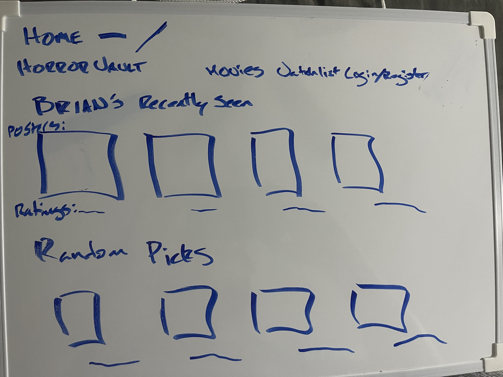
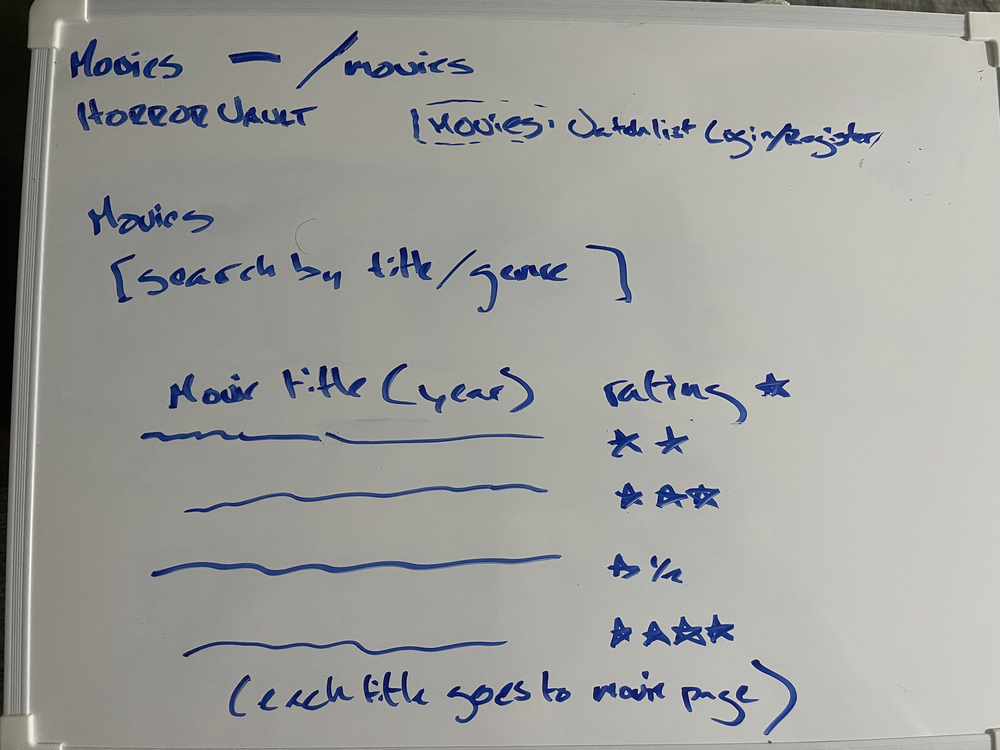
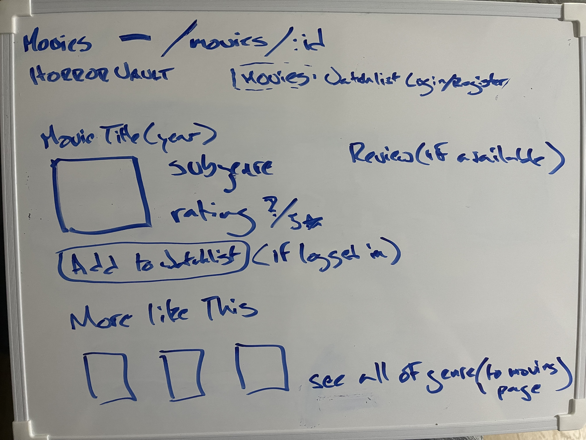
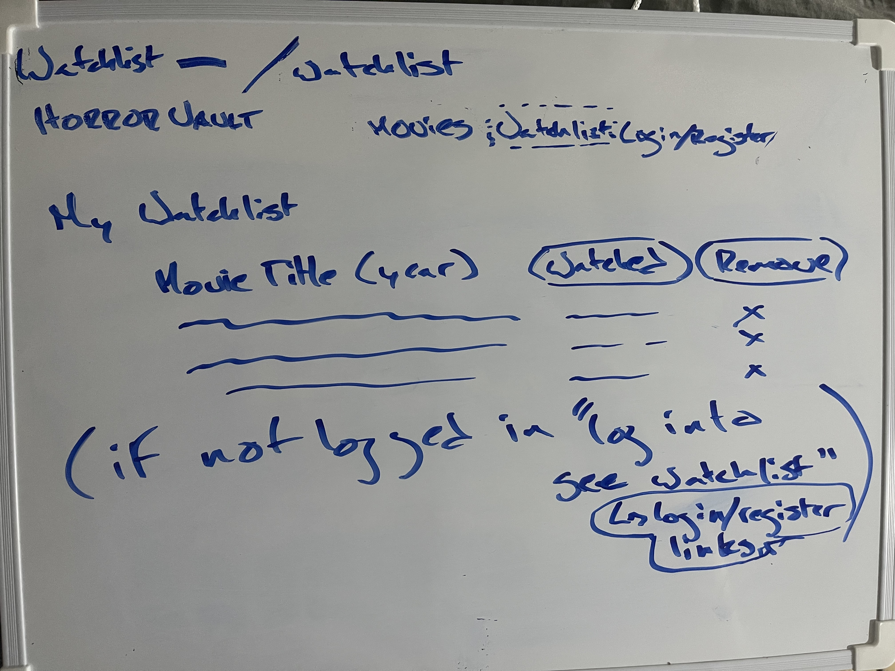
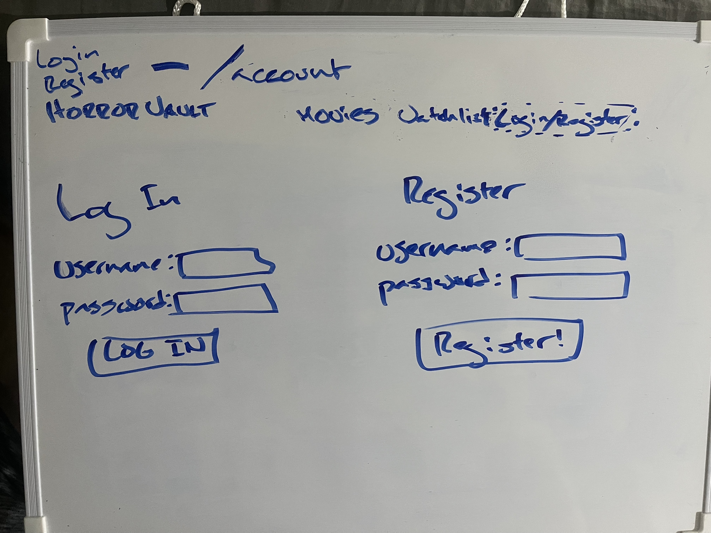

# Horror-Vault

A horror movie database built from my Letterboxd ratings to which help recommend and find new movies to watch

## Elevator pitch

Horror Vault will be a horror movie database built from my own Letterboxd ratings and reviews. Every movie will be tagged by subgenre, like "slasher", "folk horror", "found footage"... so you can browse by the kind of horror you're in the mood for based off my own appraisals of said movies and/or then find similar movies based off the tags and my ratings.

It will have a sign-up/login feature so people can browse the selection and save movies to their watchlist and mark what they've watched. Every movie page suggests more picks from the same subgenre, ranked by my ratings. It's like a smaller Letterboxd, but (for now) just built around horror and sorted and presented off my own estimations of the films as an interactive movie blog of sorts.

## MVP core features

- A Homepage with recent entries and/or random suggested highly regarded movies
  User story:
  As a visitor I'd like to see what 'Brian' has been seeing and some random suggestions based off what he's rated highly already so that I can find something unexpected to watch

- An accounts section where users can register, log in and log out.
  User story:
  As a visitor and new enthusiast of 'Brian', I'd like to login/create an account so that I can keep track of specific movies I've seen of Brian's viewed that appeal to me

- Browse function to go through the selection of movies through name, year, subgenre tag based off data pulled from my letterboxd to fill out which movies appear and certain details
  - Search function to find movies by title or the used tags
  - Detailed page for each movie with brief info on the movie and my rating and review (if available).
    User story:
    As a visitor I'd like to see all of Brian's selection and to be able to search for certain titles or subgenres so that I can better cater to my own tastes by finding the stuff I'm more interested in and/or see what Brian's appraised of movies I've already seen

- Watchlist feature for logged-in users to add or remove movies from their list and/or mark as watched
  User story:
  As a visitor I'd like to add things to my watchlist so that I have them all placed here in a single list for me to see and check off instead of finding in the larger movie list

- A "more like this" for each movie page that'll suggest my highest-rated or "liked" (good-bad movies) movies from the same subgenre.
  User story:
  As a visitor I'd like to see other movies within the same subgenre so clicking a "more like this" expands a selection to see all titles of the subgenre

- User ratings and reviews, where users can post their own comments under each movie, their own rating being just a percentage based off "thumbs up/thumbs down" as to display alongside each title
  User story:
  As a visitor I'd like to validate Brian's judgement for movies by contributing to a comments section and a like ratio so that I can share my own feelings towards Brian's opinions and maybe help show any biases he might have to help future visitors' experience

## Stretch goals

- A Suggested For You function with suggestions based on the subgenre a user has watched or liked most.

- Sort feature to go by rating or year, maybe also a filter for short films or "liked films"

- A letterboxd link to the movie for more expansive details on the movie

- Maybe also a directors table to also sort by or search by

-Comme

## Project management

Tickets are tracked on a GitHub Projects board for this repo, with To Do, In Progress and Done columns.

Since this is a solo project, every ticket is assigned to me, and I'll work through them in this order:

1. Database tables
2. Movie data and seed file (Letterboxd data, subgenres, posters)
3. Users routes (register, login)
4. Movies and subgenres routes
5. Watchlist routes
6. React setup: page routes and nav bar
7. Account page (login and register forms)
8. Home page (recent and random picks)
9. Movies page (search)
10. Movie details page (more like this, add to watchlist)
11. Watchlist page
12. Styling

## Database schema

```sql
CREATE TABLE users (
  id serial PRIMARY KEY,
  username text UNIQUE NOT NULL,
  password text NOT NULL
);

CREATE TABLE subgenres (
  id serial PRIMARY KEY,
  name text UNIQUE NOT NULL
);

CREATE TABLE movies (
  id serial PRIMARY KEY,
  title text NOT NULL,
  year integer,
  poster_url text,
  subgenre_id integer NOT NULL REFERENCES subgenres(id) ON DELETE CASCADE,
  rating decimal,
  review text,
  liked boolean NOT NULL DEFAULT false,
  date_logged date
);

CREATE TABLE watchlist (
  id serial PRIMARY KEY,
  user_id integer NOT NULL REFERENCES users(id) ON DELETE CASCADE,
  movie_id integer NOT NULL REFERENCES movies(id) ON DELETE CASCADE,
  watched boolean NOT NULL DEFAULT false
);
```

## API endpoints

Users

- POST /users/register - creates a new user (users)
- POST /users/login - logs a user in (users)

Subgenres

- GET /subgenres - gets all subgenres (subgenres)

Movies

- GET /movies - gets all movies (movies, subgenres)
- GET /movies/recent - gets my most recently logged movies (movies)
- GET /movies/random - gets random highly rated movies (movies)
- GET /movies/:id - gets one movie (movies, subgenres)
- GET /movies/:id/similar - gets my highest-rated or liked movies in the same subgenre (movies)

Watchlist (must be logged in)

- GET /watchlist - gets the user's saved movies (watchlist, movies)
- POST /watchlist - adds a movie to the user's watchlist (watchlist)
- PUT /watchlist/:id - marks a saved movie as watched or not watched (watchlist)
- DELETE /watchlist/:id - removes a movie from the user's watchlist (watchlist)

## Wireframe










